 

---

## About me

I'm a Data Science master's student at **ISLAIB**, and I have a problem: I can't look at a spreadsheet without wondering what's hiding in it.

---

## Patterns, mostly

The part of the job I enjoy most is the moment a messy cloud of points turns out to have structure. Unsupervised learning is the closest thing data science has to detective work.

---

And this is what happens when I skip the validation set and keep training "just a little longer":

---

## Hypotheses I have tested

| Hypothesis | Result | Confidence |
|---|---|---|
| More coffee leads to more productivity | r = 0.87 | n = 1, do not @ me |
| Cleaner data leads to a happier me | Strongly significant | p < 0.001 |
| A "quick analysis" takes ten minutes | Rejected | Every single time |
| I will document the notebook later | Rejected | Future me disagrees |

---

## Toolbox

| Area | Tools |
|---|---|
| **Analysis** | Python, Pandas, NumPy, SQL |
| **Visualization** | Matplotlib, Seaborn, Plotly |
| **Machine learning** | scikit-learn, PyTorch (in progress) |
| **Workflow** | Jupyter, Git, VS Code |

---

## Currently

- Finishing my Data Science master's at ISLAIB
- Exploring machine learning, time series, and better ways to show what the data says
- Learning to stop saying "just one more feature"
- Open to collaborations, internships, and datasets with interesting questions

---

*"In God we trust. All others must bring data."* (attributed to W. Edwards Deming)

 

